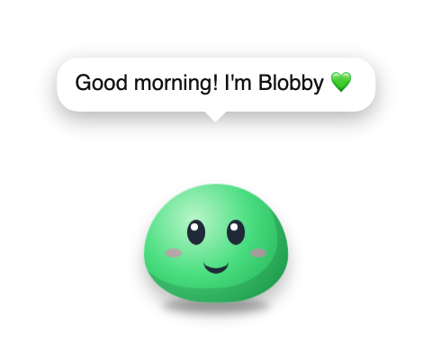
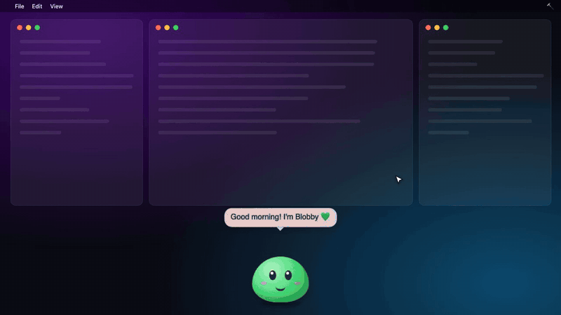
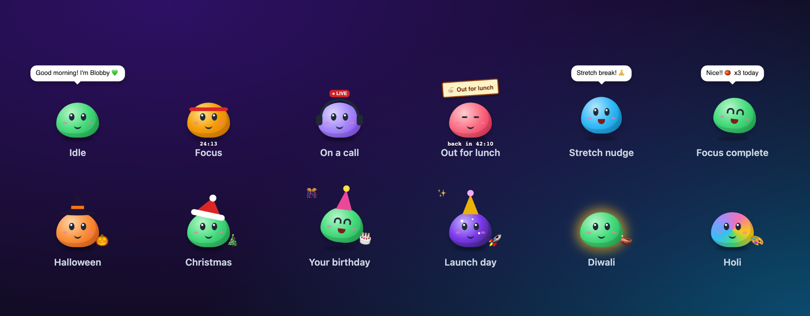
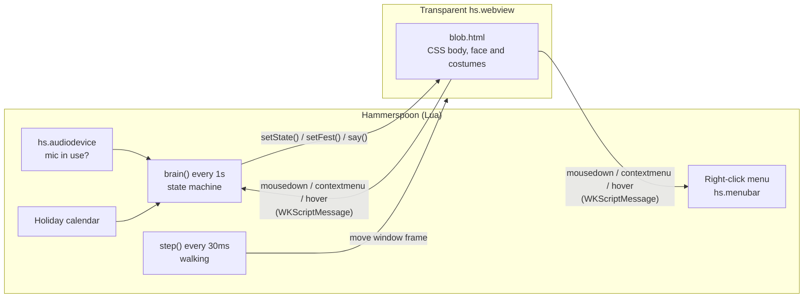

<div align="center">



# Blobby

**A tiny desktop pet for macOS that helps you focus, take breaks and smile a little.**

Blobby walks along the bottom of your screen. Click it to start a focus timer. It puts on headphones when you're on a call, holds up a sign when you're at lunch, reminds you to stretch and drink water, and dresses up for holidays and your birthday.

[](https://www.hammerspoon.org)
[](https://www.hammerspoon.org)
[](blobby/init.lua)
[](LICENSE)



<sub>🎬 <a href="docs/media/demo.mp4">Watch the full-quality MP4</a></sub>

</div>

---

## ✨ Features

| | |
|---|---|
| 🎯 **Focus sessions** | Click Blobby to start a 25-minute focus session. It puts on a headband and shows a countdown, then chimes and adds 🍅 to today's count when you're done. |
| 🎧 **Call detection** | Blobby turns purple, puts on headphones and shows a **● LIVE** tag whenever your microphone is in use, in Zoom, Teams, Meet, Slack huddles or any other app. It also stays quiet during calls. |
| 🍜 **Away modes** | Right-click Blobby to pick Lunch, Coffee, Walk or BRB. It shows a sign with a "back in…" countdown. |
| 🧘 **Gentle nudges** | Reminders to stretch every hour and drink water every 90 minutes. Both timers restart after breaks. |
| 🎃 **Costumes** | Outfits for Halloween, Diwali, Christmas, Holi, Lunar New Year, Thanksgiving, New Year's and more. You can add **your birthday** and **your own special days**. |
| 🏡 **Drag it anywhere** | Drag Blobby to a new spot and it remembers it, and only wanders nearby. It works on any monitor. |
| 🔒 **Private** | Runs only on your Mac, with no network, telemetry or accounts. It checks only *whether* the mic is in use and never records audio. |

<div align="center">
  
</div>

## 🚀 Quick start

```bash
git clone https://github.com/pallaviraiturkar0/blobby.git
cd blobby && ./install.sh
```

The installer:
1. Installs [Hammerspoon](https://www.hammerspoon.org) with Homebrew, if it isn't already installed
2. Copies Blobby into `~/.hammerspoon/blobby/`
3. Adds two lines to `~/.hammerspoon/init.lua` and reloads Hammerspoon

> [!IMPORTANT]
> The first time you run Hammerspoon, macOS asks for **Accessibility** permission. Allow it under **System Settings → Privacy & Security → Accessibility**, then choose **Reload Config** from the 🔨 menu-bar icon.

<details>
<summary><b>Manual install</b></summary>

```bash
brew install --cask hammerspoon
mkdir -p ~/.hammerspoon/blobby
cp blobby/init.lua blobby/blob.html ~/.hammerspoon/blobby/
```

Then add this to `~/.hammerspoon/init.lua`:

```lua
blobby = require("blobby")
blobby.start()
```
</details>

## 🕹️ Controls

| Action | What happens |
|---|---|
| **Click** | Starts or stops a focus session, or ends an away mode early |
| **Right-click** | Opens the menu: Focus 25 or 50 minutes, 🍜 Lunch, ☕ Coffee, 🚶 Walk, ⏳ BRB, 👋 I'm back, and today's 🍅 count |
| **Drag** | Moves Blobby to a new home spot, which it remembers |
| **Hover** | Blobby says something nice 💚 |
| <kbd>⌃</kbd><kbd>⌥</kbd><kbd>⌘</kbd><kbd>B</kbd> | Hides or shows Blobby |

## ⚙️ Configuration

Pass any of these options to `start()`. Every option is optional.

```lua
blobby = require("blobby")
blobby.start({
  focusMinutes   = 25,          -- the right-click menu also offers twice this length
  stretchMinutes = 60,
  waterMinutes   = 90,
  wander         = 300,         -- how far (in px) Blobby roams from its home spot
  birthday       = "07-14",     -- MM-DD: 🎂 party hat and confetti
  specialDays    = {
    { date = "2030-01-15", days = 1, costume = "launch", prop = "🚀", greeting = "Launch day! Ship it! 🚀" },
  },
  hotkeyMods     = { "ctrl", "alt", "cmd" },
  hotkeyToggle   = "B",
})
```

`specialDays` is for one-off days like product launches, conferences or anniversaries. Built-in costumes you can reuse: `launch`, `birthday`, `newyear`, `halloween`, `christmas`, `diwali`, `holi`, `stpatricks`.

<details>
<summary><b>Built-in holiday calendar</b></summary>

| When | Costume |
|---|---|
| Dec 31 – Jan 1 | 🎉 Gold party hat |
| Lunar New Year | 🧧 |
| Feb 14 | 💘 |
| Mar 17 | 🍀 Green body |
| Holi | 🎨 Rainbow body |
| Easter | 🐣 |
| Oct 24 – 31 | 🎃 Pumpkin body and witch hat |
| Diwali | 🪔 Golden glow |
| 4th Thursday of Nov | 🦃 |
| Dec 20 – 26 | 🎄 Santa hat |

Holidays that follow the lunar calendar, plus Easter, fall on different dates each year. Their dates live in the `DATED` table in [`blobby/init.lua`](blobby/init.lua), and pull requests that add future years are welcome.
</details>

## 🧠 How it works

Blobby is about 350 lines of Lua and 100 lines of HTML and CSS. It has no build step and no dependencies apart from Hammerspoon.



- **Body:** a borderless, transparent `hs.webview` that floats above other windows and appears on every Space. Everything you see, including the face, hats, headphones and signs, is CSS that switches on body classes such as `.focus`, `.call` and `.away`, plus a `data-fest` attribute for costumes.
- **Brain:** a once-a-second state machine with a fixed priority order: **away → call → focus → reminders → wander**. Costumes are added on top of whatever mode Blobby is in.
- **Call detection:** `hs.audiodevice:inUse()` checks every input device, so Blobby works with any meeting app and never reads audio.
- **Saved data:** Blobby's home spot and today's 🍅 count are stored with `hs.settings`.

## 🎨 Make it yours

- **Add a costume:** add a CSS rule for `[data-fest=yourkey]` in [`blob.html`](blobby/blob.html), then refer to it from `specialDays`.
- **Change the colours:** each mode is a `radial-gradient` on `#blob`.
- **Add things it says:** edit the `PETS` table in [`init.lua`](blobby/init.lua).
- **Regenerate the media:** `cd scripts && npm i && npx playwright install chromium && node render-media.mjs`

## ❓ Troubleshooting

<details>
<summary>Blobby doesn't appear</summary>

Check that Hammerspoon has Accessibility permission, then choose **Reload Config** from the 🔨 menu. Open **Console** from the same menu to see any errors.
</details>

<details>
<summary>It shows headphones when I'm not on a call</summary>

Another app is using your microphone, such as a dictation tool, a voice assistant or a browser tab. Close that app or tab and Blobby goes back to normal.
</details>

<details>
<summary>Uninstall</summary>

Delete `~/.hammerspoon/blobby/` and remove the `blobby` lines from `~/.hammerspoon/init.lua`. You can also run `blobby.stop()` in the Hammerspoon console.
</details>

## 🤝 Contributing

Issues and pull requests are welcome, especially new costumes, festival dates for future years and accessibility improvements. Please keep Blobby small, fast and private.

## 📄 License

[MIT](LICENSE) 💚
